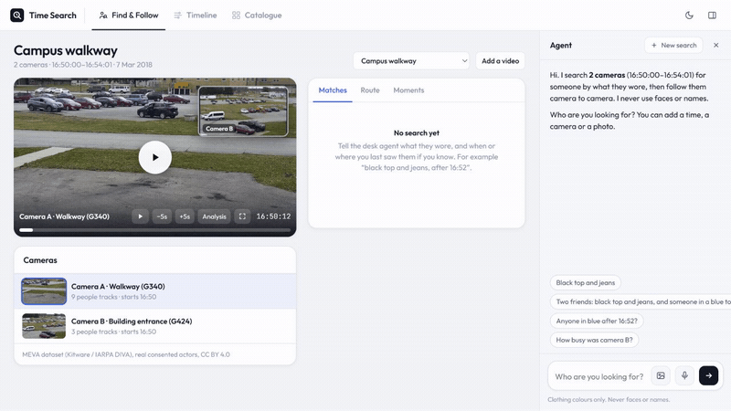
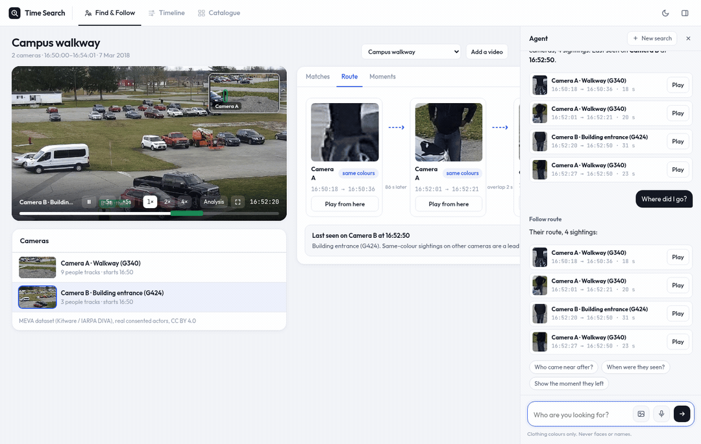
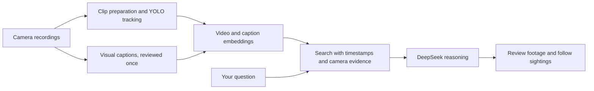

# Time Search

Find a moment in camera footage by describing it. Confirm a likely match, retrace its sightings across cameras,
and inspect what happened nearby. Each result links to its recording and source time.

**[Open the Time Search demo](https://team-13-vss.thecosmoslabs.com/app/)**



The recording shows the running product. See [the recording notes](docs/time-search/README.md) for the exact
flow and which services it uses.

## What you can do

- Search for an adult by visible clothing, a time window and a camera.
- Review the candidate in the original footage before confirming it.
- Move through camera sightings on a shared timeline and check nearby activity.
- Ask follow-up questions and open the evidence behind an answer.
- Prepare new video locally with detection, reviewed captions and embeddings.

Clothing and timing help find candidates. They do not establish a person's identity. Camera-local tracker IDs
and cross-camera suggestions need review; an unseen interval stays unknown.

Select a sighting to play the footage at its source time:



## How it works



The local ingestion path uses Luna to draft visual captions once, followed by a review against the frames.
Cosmos Embed1 supplies video and text vectors. Search combines vectors with SQLite FTS5, then sends selected
evidence to the supplied DeepSeek V4.1 Flash API for the answer. The ingestion scripts and prompts are included;
Luna processing is an offline step rather than an API service started by this repository.

The app also has adapters for the hosted VAST video stack. Local indexing and hosted ingestion are separate
paths; a queued hosted upload is not treated as searchable. The interface reports when a service or prepared
dataset is unavailable.

## Run the app

Use Python 3.10 or newer, with ffmpeg available on `PATH` for video preparation:

```sh
python -m venv .venv
# Activate .venv, then:
python -m pip install -r street-time-machine/requirements.txt
cd street-time-machine
python -m uvicorn stm.server:app --host 127.0.0.1 --port 8780
```

Open [Time Search locally](http://127.0.0.1:8780/demo.html). The main demo needs prepared camera data. The
[app setup guide](street-time-machine/README.md) explains camera configuration, analysis commands and model
connections. The classic interface at `/` includes a labelled synthetic fixture for checking a fresh checkout
without footage or model inference.

## Code

| Folder | Purpose |
|---|---|
| [street-time-machine/](street-time-machine/) | Time Search web app, camera search, route suggestions, nearby activity, API and analysis modules. The Python package remains `stm`. |
| [examples/local-video-search/](examples/local-video-search/) | Portable local ingestion, YOLO tracking, reviewed-caption indexing, Cosmos embeddings, hybrid search and the DeepSeek worker. |
| [examples/camera-gallery/](examples/camera-gallery/) | Review connected camera clips on a shared clock and export a selection for ingestion. |
| [vastkit/](vastkit/) | Clients and local model servers for VSS, VAST storage, GPU services and inference. |
| [deploy/street-time-machine/](deploy/street-time-machine/) | Kubernetes packaging, prepared-data transfer and app routing. |
| [docs/TOOLKIT.md](docs/TOOLKIT.md) | SDK installation, endpoint configuration and API commands. |

Footage, credentials, model weights, vector caches and runtime databases stay local or in the configured
platform storage. The examples include configuration templates and invented schema fixtures. Retain source
credits and licence terms for any footage you supply.

## Checks

```sh
python -m pytest tests
python -m unittest discover -s examples/camera-gallery/tests -v
python -m unittest discover -s examples/local-video-search -p "test_*.py" -v
python -m compileall -q examples street-time-machine/stm street-time-machine/scripts deploy/street-time-machine
python scripts/check_secrets.py --all
```

The app has its own tests under `street-time-machine/tests/`; some require prepared footage. Follow its setup
guide for the offline checkout checks. GPU processing needs the optional dependencies described in the SDK
guide and each example.

## Licences

This repository has no `LICENSE` file and grants no software licence. Dependencies and model weights have
their own terms. Ultralytics is optional and uses AGPL-3.0. Demo recording credits and modifications are listed
with the recording. Full source recordings are not included in this repository.
