# Video Atlas

Video Atlas is a collection of video search and analysis tools: Street Time Machine, fifteen focused
experiments, and the `vastkit` Python toolkit. Draw a motion path to find matching tracks, inspect a camera's
blind intervals, check a redacted export, or rewind a street scene with visual evidence.

There are **16 apps and prototypes** here: the fifteen numbered experiments and Street Time Machine.
Street Time Machine combines ten analysis features: synopsis, visibility and parking ledger, day comparison,
nearby activity, questions with evidence, caption checks, traffic flow, highlights, object search and briefing.
The shared SDK supports them.

## See the demos

All fifteen experiments have an animated preview below. The [full gallery](docs/DEMOS.md) explains what each
recording shows, its evaluation limits and the footage credits. Smaller GIFs load here; click one for details.

| | |
|---|---|
| **01 Release Desk**<br>[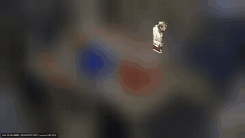](docs/DEMOS.md#01-release-desk) | **02 Overnight Ledger**<br>[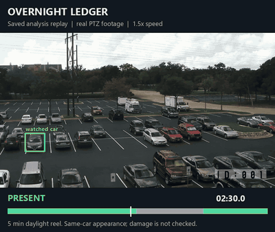](docs/DEMOS.md#02-overnight-ledger) |
| **03 Leak Test**<br>[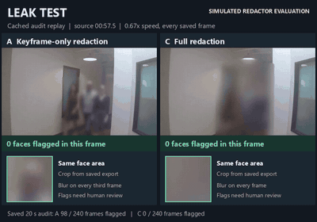](docs/DEMOS.md#03-leak-test) | **04 Night Exit**<br>[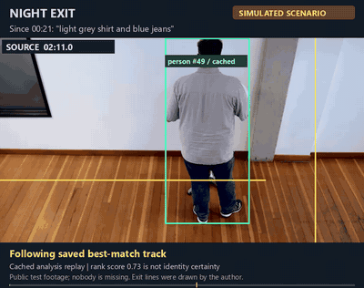](docs/DEMOS.md#04-night-exit) |
| **05 Day 14**<br>[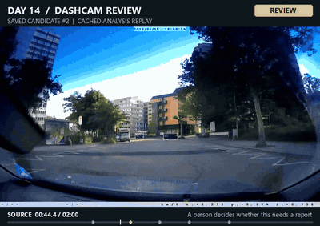](docs/DEMOS.md#05-day-14) | **06 Blind Time**<br>[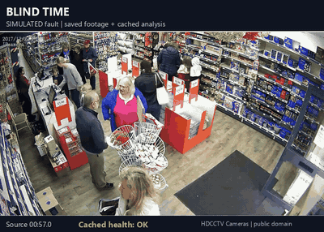](docs/DEMOS.md#06-blind-time) |
| **07 MIMIC**<br>[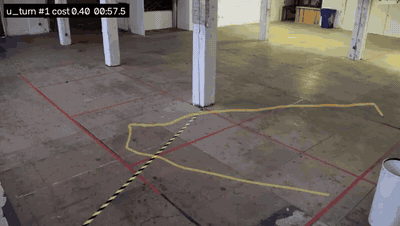](docs/DEMOS.md#07-mimic) | **08 On the Line**<br>[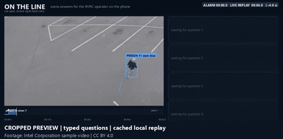](docs/DEMOS.md#08-on-the-line) |
| **09 Between the Lines**<br>[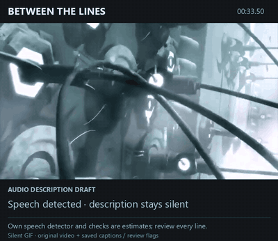](docs/DEMOS.md#09-between-the-lines) | **10 Uncut**<br>[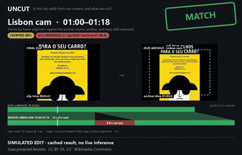](docs/DEMOS.md#10-uncut) |
| **11 Last Upright**<br>[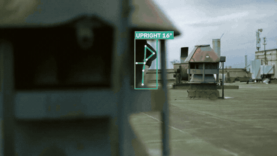](docs/DEMOS.md#11-last-upright) | **12 Hide and Seek**<br>[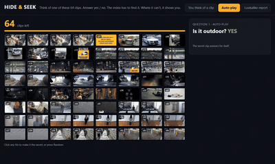](docs/DEMOS.md#12-hide-and-seek) |
| **13 Pinch Point**<br>[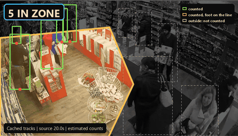](docs/DEMOS.md#13-pinch-point) | **14 Lane Call**<br>[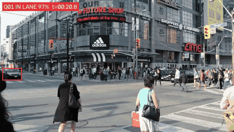](docs/DEMOS.md#14-lane-call) |
| **15 Private View**<br>[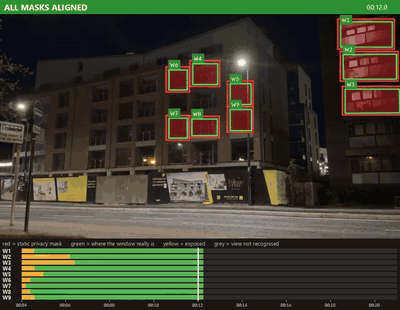](docs/DEMOS.md#15-private-view) | **Street Time Machine**<br>[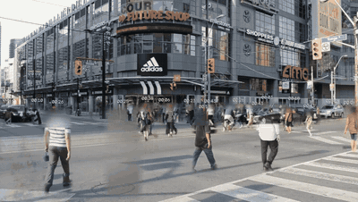](docs/DEMOS.md#street-time-machine) |

The gallery combines exported video, recorded interface interactions and walkthroughs of saved results.
Simulation labels remain visible. Street Time Machine's synopsis combines objects from different source times.

Source code, configuration examples, labelled test cases, measured result summaries and run instructions are
included. Full recordings, model weights, caches and credentials stay local.

## Where to start

| Path | Contents |
|---|---|
| [street-time-machine/](street-time-machine/) | Street camera app: synopsis, parked-car changes, nearby tracks, questions with visual evidence and caption checks. See its [README](street-time-machine/README.md) for setup and the module commands. |
| [prototypes/](prototypes/) | Fifteen experiments, each with a README, implementation and smoke checks. The table below links each one. |
| [docs/DEMOS.md](docs/DEMOS.md) | Animated previews for all fifteen experiments and Street Time Machine, with source credits and evaluation limits. |
| [vastkit/](vastkit/) | VSS and GPU clients, W&B / OpenAI-compatible LLM helpers, VastDB and S3 utilities, media processing, mocks and local model servers. |
| [docs/TOOLKIT.md](docs/TOOLKIT.md) | Full SDK setup, endpoint configuration, command reference, deployment and operational details. |
| [docs/API_NOTES.md](docs/API_NOTES.md) | API request and response shapes, known quirks and differences between mocks and hosted services. |
| [deploy/](deploy/) | Team-namespace deployment script and an API proxy with an allowlist of routes. |
| [tests/](tests/) | SDK tests against local mocks. |

The experiments include local stand-ins for hosted services. Their README files describe which components were
used, which outputs were measured, and which integrations still need work. Mock rankings and canned model
responses are useful for wiring tests, but are not evidence of search or model quality.

## Install the toolkit

Use Python 3.12 for the pinned requirements. Install [uv](https://docs.astral.sh/uv/) and make `ffmpeg` and
`ffprobe` available on `PATH` for video processing. Run these commands from the repository root:

```sh
uv venv .venv --python 3.12
uv pip install --python .venv -r requirements.txt
uv pip install --python .venv -e .
```

Activate the environment before the remaining commands. On PowerShell:

```powershell
.\.venv\Scripts\Activate.ps1
```

On Linux or macOS:

```sh
source .venv/bin/activate
```

The SDK also supports Python 3.10 and 3.11 through its dependency ranges: `pip install -e ".[all]"`.
The exact pins need Python 3.12 or newer. GPU servers and individual experiments have additional dependencies;
see the [toolkit guide](docs/TOOLKIT.md#setup) and the selected experiment's README before running them.

## Run locally

Check the environment without calling hosted services:

```sh
python -m vastkit doctor --offline
```

Start both API mocks:

```sh
python -m vastkit mock
```

In a separate shell using the same environment, set `VSS_MOCK=1` to use the mock VSS and GPU endpoints.
For hosted services, copy [.env.example](.env.example) to `.env` and fill in the endpoints and credentials.
The [configuration reference](docs/TOOLKIT.md#setup) explains `VAST_ENV_FILE`, VM config discovery and proxies.

Street Time Machine includes a small, clearly labelled synthetic demo for a fresh checkout:

```sh
cd street-time-machine
python -m uvicorn stm.server:app --host 127.0.0.1 --port 8780
```

Open [the local app](http://127.0.0.1:8780). Follow its [README](street-time-machine/README.md) to prepare real
camera inputs and module outputs. The bundled demo uses synthetic records and preset answers; it does not run
model inference.

## Experiments

| Experiment | What it explores |
|---|---|
| [Release Desk](prototypes/01_release_desk/README.md) | Select a requester, redact the surrounding footage and check the export. |
| [Overnight Ledger](prototypes/02_overnight_ledger/README.md) | Track a parked vehicle and nearby activity across a recording. |
| [Leak Test](prototypes/03_leak_test/README.md) | Audit redacted exports for exposed faces. |
| [Night Exit](prototypes/04_night_exit/README.md) | Summarise exits and scene changes using video time. |
| [Day 14](prototypes/05_day_14/README.md) | Triage driving footage into incident evidence. |
| [Blind Time](prototypes/06_blind_time/README.md) | Distinguish an empty scene from a camera that could not see it. |
| [MIMIC](prototypes/07_mimic/README.md) | Search tracked objects by drawing how they moved. |
| [On the Line](prototypes/08_on_the_line/README.md) | Support an operator answering questions during a video incident. |
| [Between the Lines](prototypes/09_between_the_lines/README.md) | Fit audio descriptions into gaps in programme dialogue. |
| [Uncut](prototypes/10_uncut/README.md) | Align and inspect recordings for edits. |
| [Last Upright](prototypes/11_last_upright/README.md) | Find posture transitions and candidate falls. |
| [Hide and Seek](prototypes/12_hide_and_seek/README.md) | Turn tracked movement into an interactive search game. |
| [Pinch Point](prototypes/13_pinch_point/README.md) | Count people in drawn zones and back-test crowd thresholds. |
| [Lane Call](prototypes/14_lane_call/README.md) | Inspect traffic lanes and candidate incidents. |
| [Private View](prototypes/15_private_view/README.md) | Detect privacy-mask drift as a camera moves. |

`prototypes/protokit.py` shares tracking, local model and rendering helpers. The
[video catalogue](prototypes/videos.json) and [additional clips](prototypes/videos_extra.json) retain source
and licence metadata. Some renderer font defaults reflect the Windows development environment.

For example, after installing the experiment's dependencies and preparing its inputs:

```sh
python prototypes/07_mimic/run.py --all
```

This produces local outputs and can run GPU inference. Inspect the selected README for the narrower commands,
expected inputs, evaluation limits and runtime notes. The numeric results in those README files describe
their recorded runs. Structured result summaries and the curated GIF previews above are included; full
generated reports and videos stay local.

Prototype assets default to `data/videos/` and `data/models/`. Set `PK_VIDEOS`, `PK_MODELS` or `PK_INTEL` to use
other locations. An optional ignored `prototypes/paths.local.json` can also supply `videos`, `models` and `intel`
paths for a particular machine. The video catalogues use paths relative to the selected video root.

## Checks and publication

Run the toolkit tests and scan the files Git will publish:

```sh
python -m pytest tests
python scripts/check_secrets.py --all
```

Experiment checks run separately because they may need recordings, model weights, cached outputs or a GPU.
The secret scanner reports file names and hit types without printing the matched values. Enable the optional
commit hook with `git config core.hooksPath .githooks`; the [toolkit guide](docs/TOOLKIT.md#rules-this-repo-follows)
describes its checks and executable-bit setup.

Keep test footage local unless you have permission to use it with a hosted service. The VSS upload helper
requires an explicit ownership acknowledgement and rejects known sample-footage paths. Shared VSS tables are
read-only through the toolkit's guarded helpers. See the [deployment guide](docs/TOOLKIT.md#deploy-app) before
exposing the proxy or enabling write routes.

## Licences

This repository has no `LICENSE` file and grants no software licence. Dependencies and model weights have
their own terms. `ultralytics` is optional and uses AGPL-3.0; hosted YOLO clients do not require it. Video
catalogues retain attribution and source licences, but the recordings themselves are not included.
