# Demo gallery

Animated previews for all fifteen experiments, plus Street Time Machine. The previews include exported
videos, replays of saved analysis and recordings of prepared interfaces. GIFs have no audio. Simulation
labels and uncertainty states remain visible; each project's README describes its implementation and
evaluation limits.

## 01 Release Desk

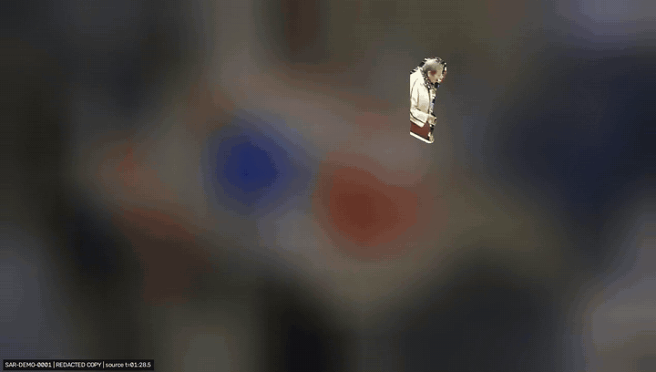

The selected subject remains visible while the surrounding shop is masked. This is an extract from the
exported video for a demonstration request. Separate detectors check exported frames; zero detected leaks
is detector evidence, and frames requiring human review remain listed in the report.

[Code and usage](../prototypes/01_release_desk/README.md). Footage: HDCCTV Cameras, public domain.

## 02 Overnight Ledger

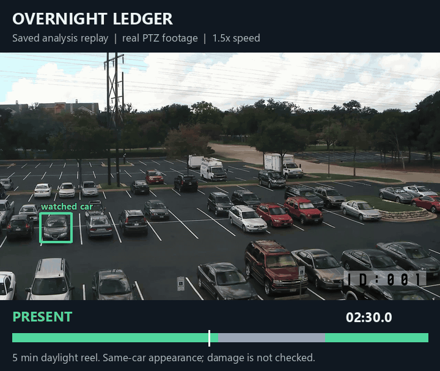

A replay of the real parking-camera recording with its saved ledger states. Presence becomes unknown
when the PTZ camera turns away from the reference view. These are cached analysis results; a nearby person
does not establish contact, and appearance matching does not establish that a car is undamaged.

[Code and usage](../prototypes/02_overnight_ledger/README.md). Footage: Supercircuits, public domain.

## 03 Leak Test

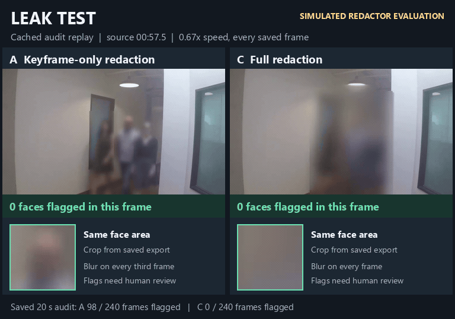

Saved Intel test-clip exports and their audit results are replayed side by side. The faulty redactions are
simulated tests, with their labels retained. A detector can reveal exposed faces that a redactor missed;
passing these checks does not prove that a person cannot be identified.

[Code and usage](../prototypes/03_leak_test/README.md). Footage: Intel Corporation, CC BY 4.0.

## 04 Night Exit

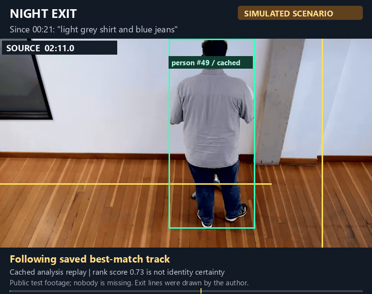

Cached tracks and crossing evidence are replayed over the source footage. The missing-resident query is a
demonstration scenario. Events use video time; clothing descriptions and ranking scores do not establish
identity.

[Code and usage](../prototypes/04_night_exit/README.md). Footage: Intel Corporation, CC BY 4.0.

## 05 Day 14

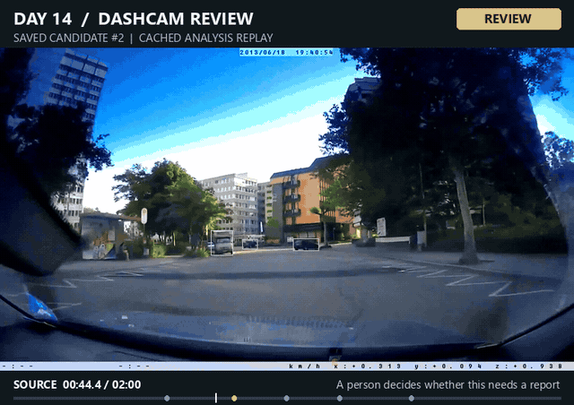

A saved driving-footage candidate is replayed with its cached target and review state. The prototype
collects visual context for review. A candidate alert does not establish that a collision occurred or
assign responsibility.

[Code and usage](../prototypes/05_day_14/README.md). Footage: Fernost, CC0.

## 06 Blind Time

Simulated camera faults are replayed alongside saved camera-health states, with the simulation label
retained. The prototype distinguishes a missing search hit from a camera that could not see. This loop
illustrates the prepared fault test rather than a live camera connection.

[Code and usage](../prototypes/06_blind_time/README.md). Footage: HDCCTV Cameras, public domain.

## 07 MIMIC

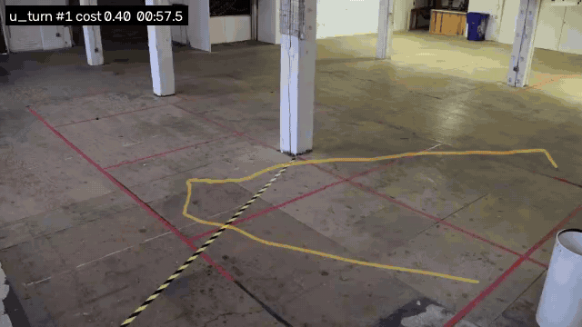

The exported top match for a drawn U-turn query, with its box, trajectory and source timestamp retained.
The query uses prepared tracks. This loop shows a search result; lower-ranked results can be false
matches, and similarity costs are not identification probabilities.

[Code and usage](../prototypes/07_mimic/README.md). Footage: Intel Corporation, CC BY 4.0.

## 08 On the Line

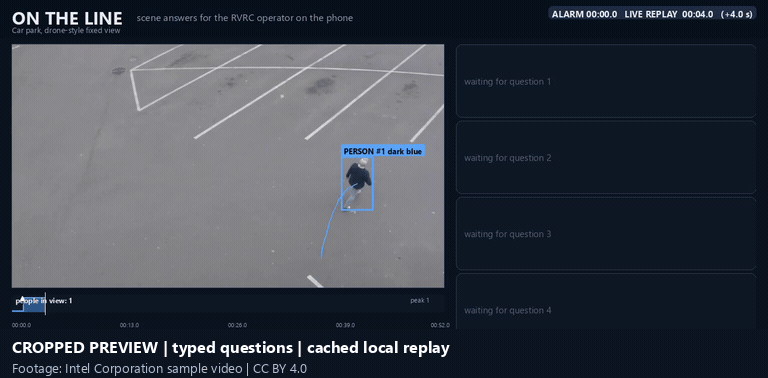

A saved incident replay presents scripted questions and scene answers from cached tracks. The cropped
preview shows the scene and answer panels. Counts and colour descriptions remain fallible, and these scripted
checks do not measure an operator's performance in a live incident.

[Code and usage](../prototypes/08_on_the_line/README.md). Footage: Intel Corporation, CC BY 4.0.

## 09 Between the Lines

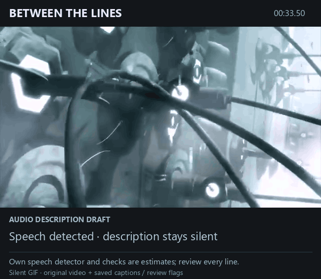

An excerpt from the saved described video, with its cached description text and AMBER review flag. This
GIF is silent, so narration and audio ducking are not demonstrated. Strict content checking found 12 of
26 lines fully accurate; speech detection and suitable gaps still require review.

[Code and usage](../prototypes/09_between_the_lines/README.md). Footage: Blender Foundation / Orange Project, CC BY-SA 2.5.

## 10 Uncut

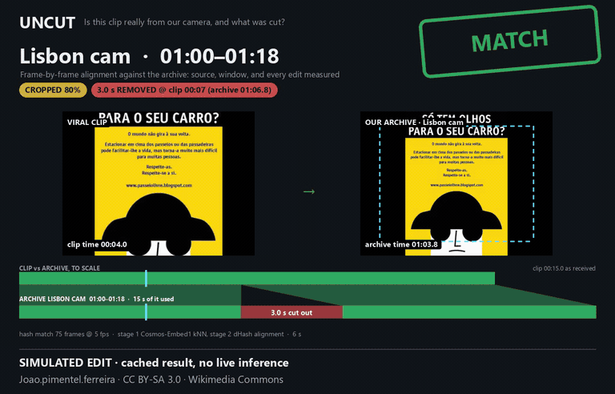

A saved recording-comparison result illustrates candidate alignment and edit evidence. Prepared query
transformations are test cases. Matches and estimated boundaries support inspection; they are not proof
that a recording is authentic or unedited.

[Code and usage](../prototypes/10_uncut/README.md). Footage: Joao.pimentel.ferreira, CC BY-SA 3.0.

## 11 Last Upright

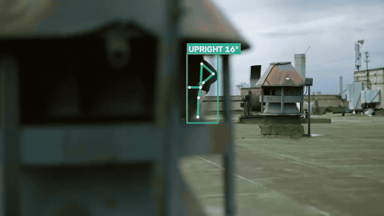

An existing annotated skateboard-fall clip shows pose tracking, a posture transition and the floor timer.
The upright view becomes legs-only before the fall. This is a test of posture logic on the recorded clip;
the results do not establish performance in care settings.

[Code and usage](../prototypes/11_last_upright/README.md). Footage: cottonbro studio, Pexels License.

## 12 Hide and Seek

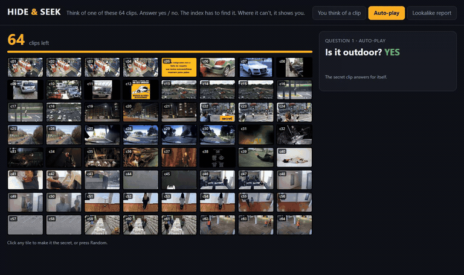

A sped-up recording of the prepared game interface. Its automatic player uses the game's own saved
attributes to answer questions and narrow the clip collection, then plays the found clip. The success
rates describe those dataset and answer rules; this is not a human play study or fresh model reasoning.

[Code and usage](../prototypes/12_hide_and_seek/README.md). The initial grid contains thumbnails from all
21 source videos in its prepared pool; the found clip is Yonge-Dundas. Credits below cover the full pool.

## 13 Pinch Point

Real footage is replayed through the project's zone-counting overlay using cached tracks. People count
when their box's bottom-centre falls inside the drawn polygon. These are estimated occupancy counts;
zone boundaries affect them, and thresholds back-tested on this footage are not validated safety limits.

[Code and usage](../prototypes/13_pinch_point/README.md). Footage: HDCCTV Cameras, public domain.

## 14 Lane Call

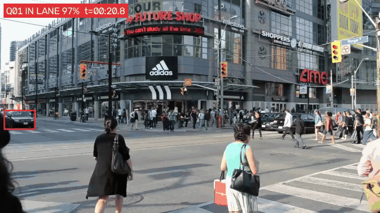

A saved stopped-vehicle alert from real signal-controlled traffic. Lane polygons are configured by hand;
IN LANE identifies position, and stopped traffic can be a queue. The displayed confidence is a heuristic
score.

[Code and usage](../prototypes/14_lane_call/README.md). Footage: Raysonho / Open Grid Scheduler / Grid Engine, CC0.

## 15 Private View

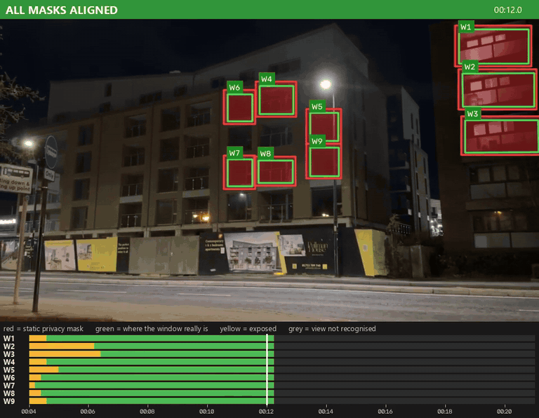

Real hand-held camera drift causes static masks to miss their test windows and changes the state to
BREACH. No motion was injected in this excerpt. The windows and masks are operator-drawn test zones;
exposure is estimated, and this run has no ground-truth labels.

[Code and usage](../prototypes/15_private_view/README.md). Footage: OathOn, CC BY-SA 4.0.

## Street Time Machine

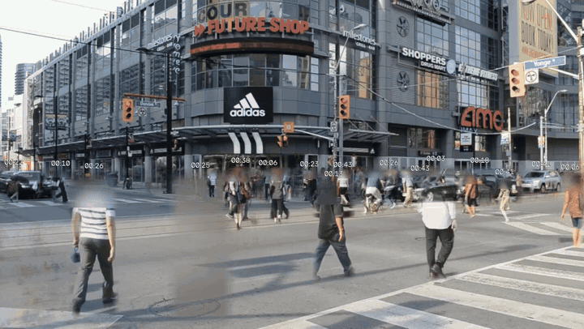

An eight-second extract from the saved street synopsis. Tracked moving objects are placed onto a shared
background, combining different source times into one view. The ghosts did not all occur together. Heads
are blurred, and the synopsis omits or caps some tracks.

[Code and usage](../street-time-machine/README.md). Footage: Raysonho / Open Grid Scheduler / Grid Engine, CC0.

## Footage credits

Previews crop, arrange and annotate source frames with masks, boxes, tracks, timestamps and interface
elements. GIF conversion also reduces resolution and frame rate. Underlying footage retains the terms
below. Our annotation and interface contributions in previews containing share-alike footage are shared
under [CC BY-SA 4.0](https://creativecommons.org/licenses/by-sa/4.0/). These image terms do not license the
repository's source code.

- **Intel Corporation:** [Intel IoT sample videos](https://github.com/intel-iot-devkit/sample-videos),
  [CC BY 4.0](https://creativecommons.org/licenses/by/4.0/). Individual clip definitions are in
  [protokit.py](../prototypes/protokit.py).
- **HDCCTV Cameras:** [Retail store CCTV footage](https://commons.wikimedia.org/wiki/File:HD_CCTV_Camera_video_3MP_4MP_iProx_CCTV_HDCCTVCameras.net_retail_store.webm),
  catalogued as public domain.
- **Supercircuits:** [Parking lot surveillance footage](https://commons.wikimedia.org/wiki/File:BLK-HDPTZ12_Security_Camera_Parking_Lot_Surveillance_Video.webm),
  catalogued as public domain.
- **Fernost:** [Dashcam Recording (urban)](https://commons.wikimedia.org/wiki/File:Dashcam_Recording_(urban).ogv),
  [CC0](https://creativecommons.org/publicdomain/zero/1.0/).
- **Blender Foundation / Orange Project:** [Elephants Dream](https://commons.wikimedia.org/wiki/File:Elephants_Dream(HQ).webm),
  [CC BY-SA 2.5](https://creativecommons.org/licenses/by-sa/2.5/).
- **Joao.pimentel.ferreira:** [Illegal parking in Lisbon](https://commons.wikimedia.org/wiki/File:Illegal_parking_in_Lisbon.ogv),
  [CC BY-SA 3.0](https://creativecommons.org/licenses/by-sa/3.0/).
- **Kathinka Engels:** [Motorway A40](https://commons.wikimedia.org/wiki/File:Motorway_A40_-_on_bridge_above_the_traffic.webm),
  [CC BY 3.0](https://creativecommons.org/licenses/by/3.0/).
- **OathOn:** [Corporation Street, Rochester, at night](https://commons.wikimedia.org/wiki/File:Corporation_Street,_Rochester,_Kent,_England,_at_night.webm),
  [CC BY-SA 4.0](https://creativecommons.org/licenses/by-sa/4.0/).
- **Raysonho / Open Grid Scheduler / Grid Engine:** [Diagonal crossing at Yonge-Dundas](https://commons.wikimedia.org/wiki/File:DiagonalCrosswalkYongeDundas.webm),
  [CC0](https://creativecommons.org/publicdomain/zero/1.0/).
- **cottonbro studio:** [Skateboard fall](https://www.pexels.com/video/person-falling-down-from-skateboard-2791953/),
  [Pexels License](https://www.pexels.com/license/).
- **Other Pexels clips in the game pool:** [lying on the floor](https://www.pexels.com/video/a-tired-woman-lying-on-the-floor-6024735/),
  [assisting an elderly man](https://www.pexels.com/video/a-person-assisting-an-elderly-man-7522207/),
  [helping a man sit](https://www.pexels.com/video/people-helping-a-man-sit-down-7522214/) and
  [sitting down](https://www.pexels.com/video/a-guy-sitting-down-6002028/), all under the
  [Pexels License](https://www.pexels.com/license/).

Source records and licences are retained in the [video catalogue](../prototypes/videos.json),
[additional clips](../prototypes/videos_extra.json) and [camera examples](../street-time-machine/cams.example.json).
