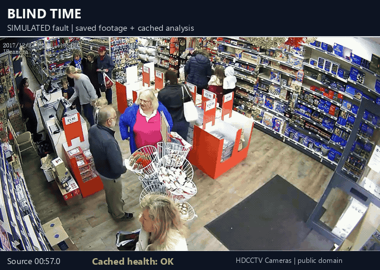

# 06 BLIND TIME: "nothing found" vs "the camera could not see"

[Animation details and footage credits](../../docs/DEMOS.md#06-blind-time).

Local prototype. Everything runs locally; footage never leaves the laptop.
Run: `.venv/Scripts/python.exe prototypes/06_blind_time/run.py --all` (warm cache 24 s; cold see "What fails"). Tests: `python test_smoke.py` (5 s, 15 checks). Held-out SIMULATED check only: `run.py --video heldout`.

## What it is
For every second of a camera feed it decides OK / DARK / FROZEN / BLUR / MOVED / OCCLUDED against a reference ("home") view, then answers
"did the camera see X between A and B?" in four states: **SEEN** (with evidence frames), **SEEN IN OTHER VIEW** (detected, but only while the camera looked somewhere else than the reference view; the asked-about place was not watched), **NOTHING FOUND** (only if the camera was OK for >= 95% of the
window) or **COULD NOT SEE** (with the blind sub-spans and the coverage %). Today's search collapses NOTHING FOUND and COULD NOT SEE into "nothing found".

## Implementation notes

- YOLO26s + ByteTrack cached tracks cover ptz and rochester; YOLO26s TensorRT runs on the middle frame of each second for the SIMULATED clip.
- `pk.vastdb` provides duckdb tables `health(sec,state,ok,usable)` and `hits(sec,cls,n,conf,usable)`. Queries use `WHERE`, `COUNT` and `SUM`, with no GROUP BY, JOIN or IN. `sql_check.agrees` is true for all 12 default queries.
- OpenCV measures ORB alignment, frame differences, blur and luminance per second on CPU.
- Cosmos3-Reason, Cosmos-Embed1 and Canary ASR are not used. There are no VLM calls in the answer path.

## Results on test footage (all numbers measured by `run.py --all`, see `results.json`)
| clip | seconds | OK | MOVED | other | headline query | plain search | Blind Time |
|---|---|---|---|---|---|---|---|
| ptz_parking (real) | 316 | 155 (49%) | 161 | - | `person 02:40-04:00` | NOTHING FOUND | **COULD NOT SEE**, blind 80 s of 80 s, coverage 0% |
| ptz_parking | | | | | `person 02:00-04:00` (the literal brief window) | SEEN | SEEN, coverage 29% (blind 85 s of 120 s = 71%: hits are a lower bound) |
| ptz_parking | | | | | `car 00:30-01:30` / `car 04:20-05:10` | SEEN / SEEN | SEEN (100%) / **SEEN IN OTHER VIEW** (coverage 0%: cars in 50 of 50 s, all in a different field of view) |
| rochester_night (real) | 84 | 22 (26%) | 62 | DARK 0 | `person 00:10-01:00` | NOTHING FOUND | **COULD NOT SEE**, blind 38 s of 50 s, coverage 24% |
| rochester_night | | | | | `person 00:00-00:10` / `car 00:00-00:20` / `car 00:30-00:50` | SEEN / SEEN / SEEN | SEEN (100%) / SEEN (100%) / **SEEN IN OTHER VIEW** (hits in 17 of 20 s, camera panned away) |
| retail_cctv + SIMULATED faults | 111 | see below | | | `person 00:15-00:23` (black) | NOTHING FOUND | **COULD NOT SEE** (DARK, 100% blind) |
| | | | | | `person 00:37-00:44` (freeze, hero head) | **SEEN** (stale frame) | **COULD NOT SEE** (FROZEN, 100% blind) |
| | | | | | `person 01:00-01:06` (blur) / `01:17-01:26` (shift) | SEEN / SEEN | SEEN, coverage 33% / **SEEN IN OTHER VIEW** (MOVED, 9 s) |

Plain-search errors over 30 s windows (person + car, ptz_parking): 20 windows, 4 plain "NOTHING FOUND" of which **3 were blind**, plus 6 plain "SEEN" windows whose hits were only in another field of view (now answered SEEN IN OTHER VIEW, no longer a contradiction). rochester_night: 4 windows, 1 of 1 "NOTHING FOUND" was blind, 1 SEEN IN OTHER VIEW.

**Per-state precision / recall on the SIMULATED clip** (per second, strict; ground truth = injected faults + the clip's own real stalls, see below):
| state | GT s | precision | recall | recall +-1 s |
|---|---|---|---|---|
| OK | 53 | 96% | 100% | 100% |
| DARK (black 10 s) | 10 | 100% | 100% | 100% |
| FROZEN (8 s injected + 16 s real stall) | 24 | 100% | 92% (22/24) | 96% |
| BLUR (sigma 10 px, 6 s) | 6 | 100% | 100% | 100% |
| MOVED (30% shift + 4 deg, 10 s) | 11 | 100% | 100% | 100% |
| OCCLUDED (40% blob, 7 s, extra fault) | 7 | 100% | 100% | 100% |

Injected faults only (natural stall excluded): recall 100% for all five. The two FROZEN misses are seconds 98-99, the soft onset of the real stall.

**HELD-OUT SIMULATED injection (thresholds frozen, scored once, no re-tuning).** The same five fault types re-injected at new times, strengths and blob seed/position into two other healthy clips (`sim.HELDOUT`): store_aisle_detection (65 s: black 6 s, freeze 7 s, blur sigma 7 for 5 s, 20% shift + 2 deg for 6 s, 30% blob for 5 s) and yonge_dundas (57 s: dim to 15% for 5 s, freeze 7 s, blur sigma 7, 22% shift + 3 deg, 30% blob). Per-second recall, strict (seconds fully inside each fault):
| fault | store_aisle (s) | yonge_dundas (s) | pooled |
|---|---|---|---|
| DARK | 6/6 | 5/5 | 11/11 = 100% |
| FROZEN | 7/7 | 7/7 | 14/14 = 100% |
| BLUR | 5/5 | 5/5 | 10/10 = 100% |
| MOVED | 6/6 | 5/5 | 11/11 = 100% |
| OCCLUDED (extra) | 5/5 | **0/5** | 5/10 = 50% |

False alarms on healthy seconds: 0/26 and 0/19. OK precision 100% and 85% (the yonge dip is exactly the missed blob read as OK). The four spec faults hold at 100% out of sample, so the in-sample 92-100% was not just fitted to one clip. **The held-out clips also exposed a real miss**: a ~30% dark blob over the sky/building of a busy Toronto intersection is read as OK (changed region only 7-12% of the frame, landmark loss 49-56% vs the 0.75 rule), consistent with the sensitivity result that ~25% is the edge. I did not re-tune after seeing it. Caveats: both clips had already served as healthy negative controls (thresholds had seen their health, not the injected faults); the injector is the same code (reflected-border shift, flat ellipse, Gaussian blur); only 5-7 s per fault.

**Sensitivity clip** (SIMULATED, 3 full seconds per variant): blur sigma 2/4/6/10 px all caught; shift 5% missed, 10/20/30% caught; dim to 50% missed, 25% and 10% caught (DARK); blob 15% missed, 25% and 40% caught. 11 clean seconds on that clip: 0 false alarms.

**Negative controls (healthy fixed cameras, I viewed contact sheets):** one_by_one_person_detection (139 s), yonge_dundas (56 s), store_aisle_detection (65 s): 260 s, 100% OK, 0 false alarms. ptz home view (155 s) and rochester opening (22 s): 0 false alarms against my eyeball labels.

Compute (this laptop, shared with ~15 other jobs): ptz extract 71-310 s depending on load (about real-time speed at best), rochester 25 s, SIMULATED clip 31 s + YOLO (6 s idle, 233 s queued behind other jobs on the GPU lock), `--all` warm cache 24 s.

## Eyeball checks (frames I looked at)
- Contact sheets of ptz_parking (24 frames), rochester_night (12), lisbon_parking (20), retail_cctv (8). **lisbon_parking is not a fixed camera**: it is a slideshow of still photos and title cards (median consecutive-frame difference 0.05 on a 0-255 scale, i.e. near-identical frames between cuts), so it cannot be a "healthy camera" base for fault injection. I used retail_cctv (real fixed CCTV) instead and say so.
- ptz_parking, 1 s steps 150-165 s: home framing holds to 155 s, already swinging at 156 s, zoomed on a hedge at 159 s. Then every 21 s to 316 s: pole view (168-189 s), extreme out-of-focus zoom on a licence plate (210-231 s), settles on a different, closer wide view of the same lot (252-315 s). It never returns to the home framing. My labels: away = 155.5-316.2 s. Detector: MOVED 155-316; **316 of 316 seconds agree**, first-second boundary is a half-second case (counted away).
- rochester_night, 1 s steps 17-28 s and every 4 s to 84 s: opening framing (building + lamp, cars crossing) holds to ~22 s, then the camera pans to a tree-lined view and keeps wandering (76 s facade, 80 s junction); never returns. Labels away = 22.5-84.5 s; detector MOVED 22-84; **84 of 84 agree**. Scene is night but well exposed: mean luminance 46-66 of 255, lamps lit. **No second is DARK** (threshold 14 absolute or < 30% of the reference), correctly: the "dark" in the clip title is not a camera fault.
- Person detections used as evidence, cropped and viewed: ptz 120 s and 139 s (real pedestrians on the home view); rochester 0, 4, 7 s (one dark-clothed pedestrian walking along the pavement, not a poster). All real.
- retail_cctv natural stall: people stand in identical positions at 99.0, 102.0 and 104.5 s; native-resolution frame differences <= 12 grey levels everywhere for seconds 0-2 and 98-110. That is a real frozen feed inside a public clip; it is part of the ground truth.
- HELD-OUT sheets `out/heldout_store_aisle_detection/spans_sheet.jpg` and `out/heldout_yonge_dundas/spans_sheet.jpg`: store aisle shows black (00:12), a held frame (00:24), strong blur (00:35), a shifted view with a visible new left edge (00:44) and a dark ellipse over the aisle (00:54), all labelled correctly; on the yonge sheet the dim (00:11), freeze, blur and shift are labelled correctly, and the dark ellipse over the building at 00:50 is visibly there but labelled OK (the miss above).
- The three hero images re-viewed after this revision: SIMULATED hero now leads with the freeze query (SEEN struck through, STALE FRAME chip, COULD NOT SEE); ptz and rochester show SEEN IN OTHER VIEW rows in blue, so no row reads as a detection contradicting Blind Time; the ptz literal 02:00-04:00 row shows the BLIND 1 m 25 s lower-bound chip.
- SIMULATED clip frames at 5, 19, 30, 40, 61, 70, 81, 99 s, the detected-span sheet (`out/retail_cctv_SIM/spans_sheet.jpg`) and the three hero images.

## Simulated or faked (explicit)
- **All five faults on retail_cctv are SIMULATED** (`sim.py`): black frames 14.3-24.3 s; last frame held 36.7-44.7 s; Gaussian blur sigma 10 px at 1270 px width 58.2-64.2 s; view shifted 30% right + 8% down + 4 deg rotation, reflected border 76.5-86.5 s; dark-brown textured ellipse over ~40% of the frame 88.3-95.3 s (extra, not in the brief). The faulted file is re-encoded H.264 and analysed through the same path as any video. Starts are not on whole seconds; the faults are easier than real life (a flat ellipse is not a bus, a reflected border is not a real new scene).
- The sensitivity clip and the two held-out clips (`out/heldout_*`) are SIMULATED too. They use the same injector code as the in-sample ones, so they test new times, strengths and positions, not new kinds of fault.
- **Thresholds were tuned in-sample.** After my first run I changed: frozen test (mean < 0.02 over 70% of pairs -> median pair difference < 0.004 with a 0.006 settling extension and a 2 s minimum run), `moved_min_vis` 0.80 -> 0.93, `occ_frac` 0.30 -> 0.25 (baseline max on real clips 0.17), unregistrable-and-flat 0.50 -> 0.85 (a zoomed PTZ view was called OCCLUDED), unregistrable blur needs +0.40. A landmark-loss occlusion signal was added but is effectively off (`lost_frac` 0.75) because its baseline on busy scenes reaches 0.56. The in-sample sim recall is therefore optimistic; the held-out injection above (other clips, other times/strengths, frozen thresholds) is the less biased number for the four spec faults, together with the real-clip checks and negative controls.
- Detections on ptz and rochester come from the cached 15 fps YOLO26s+ByteTrack table (frame nearest each second's middle, conf >= 0.35), not a fresh run. YOLO26s stands in for DataEngine YOLO11s.
- No Cosmos3-Reason, Cosmos-Embed1 or ASR is used. Nothing is uploaded.

## What fails / limits
- **Everything is relative to a reference view.** A PTZ that moves to another preset, or the handheld-style rochester clip, is MOVED even though the camera works. Hits seen in another field of view no longer read as a contradiction: they answer SEEN IN OTHER VIEW (coverage of the reference view still shown, typically 0%). MOVED means "not the reference view", not necessarily a fault: for a PTZ that patrols on purpose, "49% of the clip showed the reference view" is a coverage statement, not an alarm. A preset library (several references, state = which one) is the obvious fix and is not built.
- The literal brief query `person 02:00-04:00` does **not** give COULD NOT SEE: a pedestrian is genuinely visible until ~02:25 and the PTZ leaves at 02:35 (away 2 m 41 s until the end of the clip, not 3 m 10 s). The hero therefore uses `02:40-04:00` (a selected window inside the away period) and shows the literal window right under it as SEEN with "BLIND 1 m 25 s: HITS = LOWER BOUND".
- OCCLUDED misses a ~30% dark blob on a busy, dark-textured scene (yonge_dundas held-out, 0/5 s).
- FROZEN cannot be told apart from a perfectly static, noise-free feed. ptz home median pair difference is 0.0076 or more against my 0.004 threshold: a margin of about 2x. Needs >= 2 s.
- Not caught (sensitivity): shifts around 5%, dimming to 50%, near objects covering < ~20% of the frame. Textureless scenes would defeat ORB registration and read as MOVED; night footage worked (rochester), an empty room worked (one_by_one).
- Per-second granularity: boundary seconds are +-1 s. The documented DataEngine segment is 5 s.
- NOTHING FOUND still depends on detector recall (YOLO at 640 px misses small far objects): it means "camera OK and nothing detected", never "nothing happened".
- Cold `--all` was not under 10 min on this machine: ptz extract 71-310 s, two faulted videos generated (35-55 s each) and analysed (30-60 s each), and the YOLO call for the SIMULATED clip queued 4-10 min behind other jobs on `gpu.lock` (6 s when idle). Idle-machine estimate ~5 min. Warm cache: 24 s.
- The hero tile "plain NOTHING FOUND answers that were blind" is computed on only 4 (rochester) or 20 (ptz) windows: small numbers. Per-state recall rests on 5-11 s per class per clip.
- Cold `--all` now also writes and analyses two more faulted clips (26-37 s to write, 11-13 s to analyse each, measured on a lightly loaded machine); it was not re-timed cold end to end. This session: `--all` with the yonge held-out clip cold (store held-out and the other features cached) took 115 s.

## Kill test result
**PASSED.** Criterion: simulated-fault recall >= 90% and PTZ away periods match eyeball.
Per-state recall (DARK, FROZEN, BLUR, MOVED) on the in-sample SIMULATED clip: 100%, 92% (strict, includes 16 s of real stall), 100%, 100%; min 91.7%. Injected-only: 100% for all five faults. **Held-out** (two other clips, new times/strengths, frozen thresholds): DARK, FROZEN, BLUR, MOVED all 100% on both clips (pooled 46/46 s); OCCLUDED (extra) 5/10 s. PTZ away period: 316/316 seconds agree with my frame-by-frame labels (away from 155.5 s, boundary within half a second). Caveat: in-sample thresholds for the first number; the held-out number is the honest one for the four spec faults.

## Files
`run.py` (CLI), `blind.py` (state detector, queries, SQL), `sim.py` (SIMULATED faults + scoring), `render.py` (hero/timeline), `test_smoke.py`, `eyeball.json` (my frame-by-frame labels), `results.json`, `out/<video>/{hero.jpg,report.html,results.json,spans_sheet.jpg}`; `out/ptz_parking`, `out/rochester_night`, `out/retail_cctv_SIM`, plus control runs in `out/{one_by_one_person_detection,yonge_dundas,store_aisle_detection}`. Footage credits are in each report footer. Held-out outputs are in `out/heldout_<clip>/`. The throwaway probe scripts were deleted.
