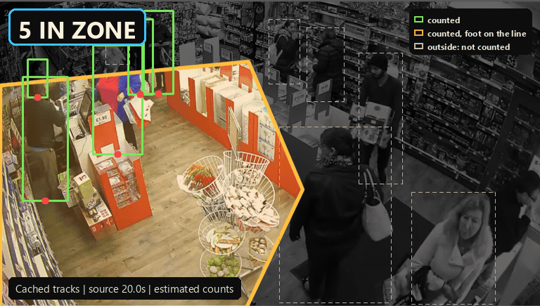

# 13 PINCH POINT REGISTER

[Animation details and footage credits](../../docs/DEMOS.md#13-pinch-point).

## What it is
A zone-based crowd register for station/venue managers: draw a polygon on a camera view, count people (feet inside the polygon) per second, back-test a trigger "N or more people for S seconds or more" over the whole recording, sweep N and recommend a threshold, and export a plan entry (Markdown + JSON with evidence frames at the peaks and an empty actions list).
It answers the ORR/Euston finding ("pinch points had no recorded, risk-assessed plan") with a plan entry that is backed by what the camera actually saw.

Run: `python run.py --all` (about 30-60 s with a warm VLM cache, about 2 min cold, no GPU needed), `python run.py --video retail_cctv --n 8 --s 3 [--gap 1]`, `python test_smoke.py`.
Trigger semantics are LITERAL: every second of the sustain window must have >= N people in the zone. `--gap 1` (off by default) forgives 1 s dips and is labelled on the hero if used.
Optional `--xcheck` recounts the evidence frames with the larger detector (yolo26l); it needs the GPU lock and took 19 min here because other prototypes held the lock.

## Implementation notes

- Cached YOLO26s + ByteTrack person boxes determine polygon-zone occupancy. Counts alone cannot locate a person inside a polygon.
- duckdb stores `zone_occupancy(video, sec, n_in_zone)`. The SQL check uses `COUNT`, `MAX` and `SUM` with WHERE, without IN, ILIKE, GROUP BY, JOIN or window functions. Python detects episodes in the retrieved series.
- Local Cosmos3-Edge makes one advisory zone-label, risk and control suggestion per clip.
- Cosmos-Embed1 and Canary ASR are not used. The mp4 footage stays local.

## Results on test footage
All numbers from `results.json`. Zone counts = person boxes with bottom-centre inside the polygon, per-second median of ~12-15 fps detections. Trigger: S = 3 s, literal rule (no dips forgiven), N = ceil(P95 of the 1 Hz series).

| clip | length | zone | peak (1 Hz / single frame) | P95 -> N | fires at N | s over N | longest | highest N that still fires |
|---|---|---|---|---|---|---|---|---|
| retail_cctv (lead) | 111 s | till and queue area | 10 / 11 | 9 | 2 (00:23-00:27, 00:48-00:51) | 12 s (11%) | 4 s | 9 |
| yonge_dundas (moving camera) | 57 s | roadway inside the kerb | 14 / 15 | 12 | 0 | 5 s (9%) | 0 s | 11 (2 fires, longest 9 s) |
| people_detection (sparse control) | 50 s | office corridor floor | 3 / 3 | 3 | 1 (00:29-00:33) | 4 s (8%) | 4 s | 3 |
| store_aisle_detection | 65 s | main shop aisle | 6 / 7 | 5 | 3 (00:28-00:43, 00:52-00:55, 00:58-01:05) | 26 s (39%) | 15 s | 5 |

Areas (25 / 450 / 30 / 40 m2) are guesses, so the hero no longer shows a density card; densities and the capacity-based N stay in `plan_entry.md` only, marked as estimates. The capacity rule (2 people/m2) would never fire on any clip.

Sweeps (N: fires / seconds at or above N). retail: 5: 5/93, 6: 9/68, 7: 7/47, 8: 5/25, 9: 2/12, 10: 0/1. yonge: 4: 3/52 (most fires at any N), 10: 2/21, 11: 2/17, 12: 0/5. store: 3: 2/48, 4: 1/40, 5: 3/26, 6: 0/2. Fire counts are not monotone in N (episodes split and merge), which is exactly why the sweep, not a single number, goes in the plan.

Effect of the trigger fix (regression finding): with the earlier 1 s dip merge, Yonge N>=12 "fired once" on the series 12, 11, 12. Literal rule: 0 fires. retail went 3 -> 2 fires and store_aisle 2 -> 3 (a dip no longer glues episodes together). `test_smoke.py` has a regression test for exactly the 12, 11, 12 case and checks that every reported fire has >= N on every second of its episode.
Alert time = episode start + S; when an episode lasts exactly S seconds (retail #2: 3 s) the alert lands as it ends. That is the cost of a sustain rule, not a bug, and the plan entry says so.

Independent recount of the evidence frames with yolo26l in the same polygon (`--xcheck`, 640 px input, run before the final evidence-frame change): yonge 12/14/11 -> 15/16/10; people 1/2/3 -> 1/2/3; retail 9/10/9 -> 10/9/8. store_aisle was 5/6/5 -> 5/6/5 but its third evidence frame changed with the literal rule and the GPU lock timed out when I re-ran it, so it is stale and not claimed. The two detectors agree within about 3 people and disagree in sign: counts are good to roughly +/-20% in crowds, not exact.

Pipeline checks (test_smoke.py, 8 tests, about 10 s, all pass): trigger semantics (literal and opt-in gap) on synthetic series, the 12/11/12 regression, feet-in-polygon rule, sweep monotone in time-over, python result equals duckdb SQL result, recount from cached tracks reproduces results.json, plan entry completeness, outputs exist and are <= 1280 px wide, kill test recorded.

## Eyeball checks (frames I viewed, and what I saw)
- Contact sheets (6 frames each) of all four clips. yonge_dundas: handheld pedestrian-eye view while walking through a scramble crossing, huge foreground faces, far kerb crowd; people_detection: empty office floor, 1-3 people walk through at 4, 21, 29 and 46 s; store_aisle: 1-6 shoppers in a crockery aisle; retail_cctv: busy till queue, 10-15 people.
- Zone previews and then hero.jpg for all four clips, twice (before and after the changes). Final heroes: the zone is tinted amber, everything outside is dimmed to grey with dashed boxes, people on the line get an amber box, the legend is in the corner; the trigger label sits in the legend row of the timeline (it no longer collides with the peak markers); MOVING CAMERA banner on Yonge, sparse banner on people_detection; the stamp reads NO FIRE AT N>=12 (blue) for Yonge instead of a green NEVER FIRED.
- First yonge zone (top edge at 0.58 of the height) counted the crowd waiting on the far kerb: frame at 16.4 s read 13 in zone but only about 4 people were on the roadway. I moved the edge to 0.62 (inside the kerb) and renamed the zone. This is tuning after looking at frames; it shows the count is boundary-sensitive.
- Ground truth, counted from plain frames with only the zone outline (before looking at boxes, except people_detection, 3 obvious people): `ground_truth.json`, six frames. Rule: feet within about 10 px of the outline count 0.5.
  - yonge 24.0 s (frame 576): I counted 11 (9-13) vs 12 detected.
  - yonge 39.5 s (frame 948): 14 (13-15) vs 14.
  - yonge 48.5 s (frame 1162): 9 (8-10) vs 11. Overlay shows the extra ones are people right at the far lane line and a pair with a bicycle.
  - retail 49.5 s (frame 648): 9 (8-10; 2 people half hidden behind the counter at the zone edge) vs 10.
  - store aisle 37.5 s (frame 2248): 5 clearly separate people vs 6 detected (the blonde woman gets two boxes; yolo26l also says 6).
  - people_detection 29.4 s (frame 353): 3 vs 3.
  - retail 23.5 s (frame 308), added for the lead clip: 7.5 (6-9) vs 9, +20.0%. 6 clear people (cashier, navy man, black-hat man, blue-jacket woman, red-hat man, a woman with a white bag) plus 3 half-hidden at the line at 0.5 each. HONEST CAVEAT: my first blind pass on the 1100 px frame was only 4 clear + 5 borderline (range 4-9); the 7.5 comes from a zoomed crop that I looked at after seeing the detector overlay, so this one is not a clean blind count.
  - retail 57.5 s (frame 753), added: 8.5 (7-10) vs 9, +5.9%, counted on a zoomed crop before seeing the boxes (7 clear incl. a blonde woman cut off at the bottom edge + 3 half-hidden at 0.5).
- Regression check: viewed evidence/zone frames of retail again; the polygon fill and greyed outside make it obvious what counts. The Yonge frames show that the zone mostly holds people walking next to the camera operator (foreground heads cut off by the bottom edge count) plus the far crosswalk; it moves with the cameraman, so it is not a fixed pinch point.
- Cosmos suggestions read: yonge "Pedestrian crossing / crossing" (right); store "Monitoring Corridor / corridor" (generic but not wrong); people_detection "Management Area / corridor" (wrong name, right type); retail "Central display area / aisle" (wrong: the zone is the till queue). Risks and controls are generic lists.

## Simulated or faked
- Nothing injected. No faults, no synthetic crowds.
- Zone areas (m2) are my eyeballed estimates (about +/-50%); every density number and the capacity-based N inherit that. The capacity rule (2 people/m2) is an assumption, not a standard I verified.
- Sustain time S = 3 s because clips are 50-111 s; real use would be 30-120 s.
- Footage is a street crossing, an office, a shop aisle and a shop till, not a station platform or concourse. No station footage was tested.
- Nothing in the hero is a density claim any more; densities / capacity N in the plan entry rest on my guessed areas.
- "VastDB" is duckdb; "DataEngine YOLO11s" is YOLO26s + ByteTrack with cached tracks; "Cosmos3-Reason" is local Cosmos3-Edge (weaker).
- The plan entry's actions, owners and review dates are placeholders by design.

## What fails / limits
- Dense or distant crowds are undercounted: detections at 640 px miss small people; far kerb crowds at Yonge were largely missed (so we excluded the kerb from the zone, which hides the genuinely crowded waiting area).
- Counts near the zone boundary flip with a few pixels: one of six hand-counted frames is off by more than 20% for this reason; the 6 vs 5 at the aisle is a double detection.
- Fixed polygon on an image plane: needs a fixed camera. The Yonge clip is handheld and walks with the crowd (its zone is effectively 'people near the cameraman'), so it is labelled a limitation demo; a PTZ camera would break the zone too.
- Feet = box bottom-centre: people half hidden behind counters or cut off at the frame edge are placed wrongly.
- P95 as the recommended N is taken from the recording's own busiest 5%, so 'WOULD HAVE FIRED' on it is close to tautological. The hero now says so and leads with the sweep (highest N that still fires, fires either side). With the literal sustain rule P95 may not fire at all (Yonge). It is a planning starting point, not a safety limit.
- Density needs a real floor area; no homography or calibration is done.
- Cosmos label/risk suggestions are generic and sometimes wrong (see above); nothing depends on them.
- Does not read the 5 s DataEngine table directly: that has no positions (see stack mapping).

## Kill test result
Criterion: zone counts within +/-20% of eyeballed counts on 3 peak frames. PASSED, narrowly: on the three peak/fire frames of the lead clip retail_cctv, errors are +20.0% (23.5 s, exactly on the edge, and not a clean blind count, see eyeball checks), +11.1% (49.5 s), +5.9% (57.5 s). Across all 8 hand-counted frames (yonge x3, retail x3, store aisle, people_detection): 7/8 within 20%, mean absolute error 11.0%; the miss is yonge 48.5 s at +22.2% (range 8-10, detector 11, people on the far lane line); the store aisle frame is also exactly +20.0% (a double detection). Treat as fine for "when is it busy" back-testing, not for exact head counts. Eyeballed numbers are mine, subjective (half-hidden people at 0.5), and detector/eyeball agreement is helped by the boundary tolerance I allowed myself.
